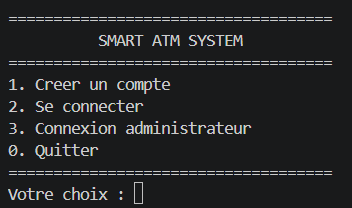

# 🏦 Smart ATM System

A console-based ATM management system developed using the **C programming language**.

## 🖥️ Application Preview



## 📌 Description

Smart ATM System is an educational C programming project that simulates the basic operations of an Automated Teller Machine (ATM).

It allows users to create accounts, authenticate themselves, manage their balances, perform transactions, and consult their transaction history.

The project also includes an administrator dashboard for managing accounts and monitoring system activity.

## ✨ Features

### 👤 User Features
- Account creation
- Secure login with account credentials
- Balance consultation
- Cash deposits
- Cash withdrawals
- Money transfers
- Transaction history
- Account information

### 🛠️ Administrator Features
- Administrator authentication
- View all registered accounts
- Monitor total money in the system
- View transaction records
- Delete accounts
- Reset account PINs
- Access system settings

### 💾 Data Management
- File handling for data persistence
- Automatic account data storage
- Input validation
- Duplicate account detection

## 🛠️ Technologies Used

- **Programming Language:** C
- **Compiler:** GCC
- **Operating System:** Windows
- **Interface:** Console / Terminal
- **Version Control:** Git & GitHub

## 📁 Project Structure

```text
Smart-ATM-System/
│
├── atm.c
├── .gitignore
├── README.md
│
└── screenshots/
    └── atm-home.png
```

**Local configuration and data files:**

```text
admin.txt       # Administrator configuration (not uploaded)
accounts.dat    # Account data generated by the application
```

These local files are excluded from GitHub using `.gitignore`.

## ⚙️ Installation & Execution

### 1. Clone the repository

```bash
git clone https://github.com/tahaammouri7-glitch/Smart-ATM-System.git
```

### 2. Open the project folder

```bash
cd Smart-ATM-System
```

### 3. Configure the administrator

Create a local file named `admin.txt` in the project folder.

Its format must contain:

- First line: Administrator username
- Second line: Administrator PIN

**Do not upload this file to GitHub.**

### 4. Compile the program

Make sure GCC is installed, then execute:

```bash
gcc atm.c -o SmartATM.exe -std=c11 -Wall -Wextra -pedantic -lm
```

### 5. Run the application

On Windows PowerShell:

```powershell
.\SmartATM.exe
```

## 🎯 Project Objectives

- Apply the fundamentals of C programming.
- Practice functions and modular programming.
- Understand file handling and data persistence.
- Improve input validation techniques.
- Develop logical thinking and problem-solving skills.
- Build a practical application using the C language.

## 🔐 Security Note

This project is developed for educational purposes only. It is not intended for real banking operations.

Administrator credentials and account data are stored locally. The current implementation does not provide production-level security or encrypted credential storage.

## 👩‍💻 Author

**Taha Ammouri**

GitHub: [@tahaammouri7-glitch](https://github.com/tahaammouri7-glitch)

---

*This project was developed for educational purposes as part of my programming learning journey.*